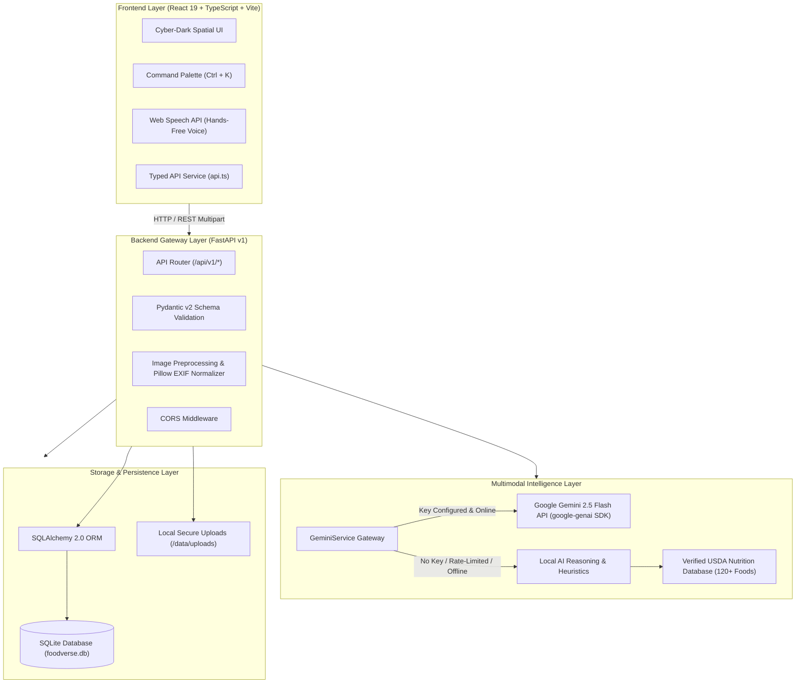

# FoodVerse AI — Multimodal Food Intelligence Agent

[](https://python.org)
[](https://fastapi.tiangolo.com)
[](https://react.dev)
[](https://www.typescriptlang.org)
[](https://vitejs.dev)
[](#-testing--quality-assurance)
[](https://oxc.rs)
[](#-spatial-user-interface-design)

> A production-grade multimodal food intelligence web platform integrating Google Gemini 2.5 Flash visual intelligence, temporal kitchen safety auditing, conversational recipe synthesis, verified USDA nutritional composition databases, and robust local offline fallback engines within an immersive **Cyber-Dark Spatial UI**.

---

## 📑 Table of Contents
- [🌟 Executive Overview](#-executive-overview)
- [🏛️ System Architecture](#-system-architecture)
- [🔬 Core AI & Intelligence Modules](#-core-ai--intelligence-modules)
- [🌌 Spatial User Interface Design](#-spatial-user-interface-design)
- [📁 Repository Structure](#-repository-structure)
- [⚡ Prerequisites](#-prerequisites)
- [🚀 Windows Installation & Quickstart](#-windows-installation--quickstart)
- [⚙️ Configuration Management](#-configuration-management)
- [📡 API Documentation](#-api-documentation)
- [🧪 Testing & Quality Assurance](#-testing--quality-assurance)
- [🚢 Render Deployment Guide](#-render-deployment-guide)
- [📚 GitHub Epics Documentation](#-github-epics-documentation)
- [🛡️ Ethical AI & Scientific Limitations](#-ethical-ai--scientific-limitations)
- [🔧 Troubleshooting Guide](#-troubleshooting-guide)
- [🗺️ Future Development Roadmap](#-future-development-roadmap)
- [📄 License & Project Links](#-license--project-links)

---

## 🌟 Executive Overview

Food-related decision-making in domestic kitchens, food businesses, and commercial hospitality has traditionally been fragmented:
- **Nutrition Tracking** relies on subjective manual logging and coarse calorie guesswork.
- **Freshness & Spoilage Assessment** is evaluated visually without structured degradation criteria.
- **Kitchen Hygiene & Food Safety** depends on infrequent, retroactive physical health inspections.
- **Cooking Guidance** is restricted to static text recipes without step-by-step cooking timers or scientific substitution logic.
- **Meal Planning** rarely reconciles strict allergen exclusions with automated, aisle-sorted grocery logistics.

**FoodVerse AI** unifies these six core culinary domains into a coherent, production-ready full-stack application. Built with **FastAPI** on the backend and **React 19 + TypeScript** on the frontend, the platform features a hybrid AI architecture: it leverages **Google Gemini 2.5 Flash** for deep multimodal vision and reasoning, while embedding **high-fidelity local AI fallback engines** and a verified **USDA FoodData Central** nutritional dataset so that every feature operates reliably even without an external API key or during network disruptions.

---

## 🏛️ System Architecture

FoodVerse AI is organized around a decoupled, four-tier architecture designed for extensibility, type safety, and zero-downtime offline resilience:



---

## 🔬 Core AI & Intelligence Modules

FoodVerse AI strictly distinguishes between **Live Multimodal Cloud AI** (Google Gemini 2.5 Flash) and **Built-in Local Fallback Intelligence** (heuristics, USDA composition matrices, and culinary databases) to ensure transparent operation under all deployment conditions:

### 1. Food Recognition & Nutritional Analysis
- **Live Multimodal Model:** Google Gemini 2.5 Flash vision inference identifying dishes, visible ingredients, culinary categories, preparation styles, and estimated macronutrients.
- **Local Fallback Engine:** Heuristic dish matching coupled with a local **USDA FoodData Central** composition database covering 120+ standard foods with dynamic portion gram scaling.
- **Scientific Guardrail:** Explicit disclosure distinguishing 2D optical geometric approximations from laboratory chemical assays.

### 2. Freshness & Spoilage Assessment
- **Live Multimodal Model:** Gemini Vision biomarker inspection detecting cuticular dehydration, surface softening, mold hyphae colonies, and enzymatic browning.
- **Local Fallback Engine:** Quantitative Freshness Scoring Index (0–100) factoring food category (Produce, Dairy, Meat, Seafood, Bakery), storage environment (refrigerated, frozen, room temperature), and elapsed duration.
- **Microbiological Guardrail:** Mandatory disclaimer stating that visual examination cannot verify the absence of odorless, invisible bacterial pathogens (*Salmonella*, *Listeria*, *E. coli*, *Clostridium botulinum*).

### 3. Restaurant Hygiene & Kitchen Safety Audit
- **Live Multimodal Model:** Multi-frame inspection auditing commercial kitchen environments against FDA Food Code and HACCP guidelines across 5 compliance vectors:
  1. *Personal Protective Equipment (PPE)*: Hair restraints, beard nets, clean aprons, single-use gloves.
  2. *Surface Sanitation*: Stainless steel prep tables, sanitizing wipe-downs, absence of debris.
  3. *Cross-Contamination Prevention*: Color-coded cutting board segregation, raw protein isolation.
  4. *Food Storage*: Container dating, lid coverage, cold rail temperature holding.
  5. *Equipment Maintenance*: Grease accumulation, clean contact surfaces, floor drains.
- **Local Fallback Engine:** Deterministic HACCP audit report generator with compliance tier grading (`Grade A`, `Grade B`, `Grade C`, `Action Required`) and timestamped remediation steps.

### 4. Smart Cooking Assistant & Conversational Recipe Builder
- **Live Multimodal Model:** Conversational culinary intelligence generating structured recipes from user pantry inputs with dietary filters and chef technique tips.
- **Local Fallback Engine:** Built-in culinary reasoning providing comprehensive recipe cards with integrated cooking timers (seconds), preparation instructions, and follow-up prompts.
- **Hands-Free Kitchen Mode:** Interactive step-by-step checklist with active countdown timers and browser **Web Speech API** text-to-speech guidance.

### 5. Smart Ingredient Substitution Engine
- **Live Multimodal Model:** Food chemistry substitution analysis explaining functional replacement behavior (leavening, moisture, emulsification, fat content).
- **Local Fallback Engine:** Curated scientific database covering 40+ staple ingredients (e.g., buttermilk, eggs, heavy cream, butter, baking powder, cornstarch, soy sauce, all-purpose flour, parmesan cheese) with exact volume/weight ratios and usage notes.

### 6. Personalized Allergen-Compliant Meal Planner
- **Live Multimodal Model:** Multi-day structured meal planner balancing target calories (kcal/day) and macronutrients across Breakfast, Lunch, Dinner, and optional Snacks.
- **Deterministic Allergen Guardrail:** Server-side validation scanner ([`validate_meal_plan_allergens()`](backend/app/services/meal_planning_service.py)) ensuring zero-contact elimination of declared allergens (Dairy, Eggs, Peanuts, Tree Nuts, Shellfish, Fish, Soy, Wheat, Sesame) before persisting records.
- **Automated Grocery Logistics:** Automatically compiles ingredients into an aisle-sorted shopping list (*Fresh Produce*, *Proteins & Seafood*, *Dairy & Alternatives*, *Pantry & Grains*, *Spices & Oils*).

---

## 🌌 Spatial User Interface Design

FoodVerse AI is crafted with an immersive **Cyber-Dark Spatial Design System**:
- **Palette Tokens:** Obsidian & deep midnight green (`#040d08`, `#06140d`, `#0b1e14`), glowing emerald (`#10b981`), luminous mint (`#34d399`), energetic lime (`#a3e635`), and warm amber (`#fbbf24`).
- **Glassmorphic Depth:** Multi-layered elevation surfaces with backdrop blur (`backdrop-filter: blur(18px)`), radial ambient glows, and refined border highlights.
- **Global Command Palette:** Triggerable at any time with `Ctrl + K` (or `Cmd + K`) for instant navigation, quick action triggering, and search.
- **Adaptive Layout:** Collapsible sidebar navigation rail optimized for high-resolution desktop monitors, tablets, and responsive mobile viewports.

---

## 📁 Repository Structure

```
FoodVerseAI/
├── backend/
│   ├── app/
│   │   ├── ai/                  # Centralized Gemini 2.5 Flash service & local fallback engines
│   │   │   ├── __init__.py
│   │   │   └── gemini_service.py
│   │   ├── api/                 # Versioned REST API routing
│   │   │   └── v1/
│   │   │       ├── __init__.py  # Master API router (/api/v1)
│   │   │       ├── cooking.py   # Cooking assistant chat & substitution endpoints
│   │   │       ├── food.py      # Food recognition & nutrition endpoints
│   │   │       ├── freshness.py # Freshness detection endpoints
│   │   │       ├── health.py    # Health check & provider liveness endpoint
│   │   │       ├── history.py   # Historical analysis retrieval & deletion
│   │   │       ├── hygiene.py   # Restaurant hygiene audit endpoints
│   │   │       ├── meals.py     # Meal plan generation, listing & deletion
│   │   │       └── settings.py  # User profile & dietary preference settings
│   │   ├── core/                # Settings & environment configuration (Pydantic Settings)
│   │   │   ├── __init__.py
│   │   │   └── config.py
│   │   ├── database/            # SQLAlchemy 2.0 database engine & session management
│   │   │   ├── __init__.py
│   │   │   └── session.py
│   │   ├── models/              # SQLAlchemy ORM models (Analysis, MealPlan, UserProfile, File)
│   │   │   ├── __init__.py
│   │   │   ├── analysis.py
│   │   │   ├── meal_plan.py
│   │   │   ├── uploaded_file.py
│   │   │   └── user_profile.py
│   │   ├── schemas/             # Pydantic v2 serialization & request/response contracts
│   │   │   ├── __init__.py
│   │   │   ├── cooking.py
│   │   │   ├── food.py
│   │   │   ├── freshness.py
│   │   │   ├── history.py
│   │   │   ├── hygiene.py
│   │   │   ├── meal_planner.py
│   │   │   └── settings.py
│   │   ├── services/            # Business logic orchestration & USDA composition adapter
│   │   │   ├── __init__.py
│   │   │   ├── cooking_assistant_service.py
│   │   │   ├── file_service.py
│   │   │   ├── food_recognition_service.py
│   │   │   ├── freshness_service.py
│   │   │   ├── hygiene_analysis_service.py
│   │   │   ├── meal_planning_service.py
│   │   │   └── nutrition_service.py
│   │   └── main.py              # FastAPI application factory, CORS & static mounts
│   ├── tests/                   # Automated pytest test harness (33 tests)
│   │   ├── __init__.py
│   │   ├── conftest.py          # Shared fixtures, test image factory & Gemini mocks
│   │   ├── test_cooking.py      # Cooking assistant & substitution tests
│   │   ├── test_food.py         # Food recognition & USDA nutrition tests
│   │   ├── test_freshness.py    # Freshness degradation tests
│   │   ├── test_gemini_service.py # Gemini service unit tests & image validation
│   │   ├── test_gemini_unconfigured.py # Unconfigured 503 error handling tests
│   │   ├── test_health.py       # Health check liveness tests
│   │   ├── test_history.py      # History logging & audit trail tests
│   │   ├── test_hygiene.py      # Hygiene audit & HACCP scoring tests
│   │   └── test_meal_planner.py # Meal generation & allergen exclusion tests
│   ├── requirements.txt         # Pinned backend Python dependencies
│   └── pyproject.toml           # Pytest configuration & package metadata
├── frontend/
│   ├── src/
│   │   ├── components/          # CommandPalette, NavigationRail, TopBar, ProfileModal
│   │   ├── pages/               # 10 page views (Landing, Dashboard, 5 Capabilities, History, Settings, About)
│   │   ├── services/            # Typed API client with automatic URL resolution (api.ts)
│   │   ├── styles/              # Spatial design system tokens & layout CSS (index.css, spatial.css)
│   │   ├── types/               # TypeScript interfaces for all system contracts
│   │   ├── App.tsx              # Main application view orchestration
│   │   └── main.tsx             # React 19 bootstrap entry
│   ├── package.json             # Frontend dependencies (React 19, Lucide React, Vite)
│   ├── tsconfig.json            # TypeScript compiler configuration
│   └── .oxlintrc.json           # OxLint linter configuration
├── docs/                        # Complete technical documentation suite
│   ├── api-documentation.md     # Detailed REST endpoint reference & payload schemas
│   ├── architecture.md          # Full system architecture & design patterns
│   ├── conclusion.md            # Capstone summary & project retrospective
│   ├── deployment.md            # Single-host & container deployment guide
│   ├── limitations.md           # Scientific boundaries, allergen safety & ethics
│   ├── project-workflow.md      # End-to-end user workflows & sequence diagrams
│   ├── setup-guide.md           # Developer environment onboarding & troubleshooting
│   └── testing.md               # Quality assurance methodology & test metrics
├── epics/                       # 6 formal GitHub Epic project specifications
│   ├── README.md                # Master Epics index
│   ├── EPIC-1-requirements-environment.md
│   ├── EPIC-2-food-recognition-nutrition.md
│   ├── EPIC-3-freshness-spoilage.md
│   ├── EPIC-4-hygiene-smart-kitchen.md
│   ├── EPIC-5-personalized-meal-planner.md
│   └── EPIC-6-interface-testing-deployment.md
├── .env.example                 # Documented environment variable template
├── .gitignore                   # Git exclusion rules (secrets, venvs, DBs, uploads)
├── pyproject.toml               # Root project metadata
├── render.yaml                  # Production blueprint for Render deployment
└── README.md                    # Master documentation (this file)
```

---

## ⚡ Prerequisites

| Component | Minimum Version | Verified Version | Notes |
|:---|:---|:---|:---|
| **Python** | 3.11+ | 3.14.1 | Required for FastAPI backend and GenAI SDK |
| **Node.js** | 18.0.0+ | 24.x | Required for Vite frontend development and build |
| **npm** | 9.0.0+ | 10.x | Node package manager |
| **Git** | 2.30.0+ | 2.47+ | Version control |
| **SQLite3** | Bundled | Bundled | Zero external setup; PostgreSQL supported via `DATABASE_URL` |
| **Google Gemini API Key** | Optional | Gemini 2.5 Flash | Free key from [Google AI Studio](https://aistudio.google.com/); local fallback active when absent |

---

## 🚀 Windows Installation & Quickstart

### Step 1: Clone the Repository
Open Windows PowerShell or Command Prompt:
```powershell
git clone https://github.com/tanuDubey-077/food_verse_Ai.git
cd food_verse_Ai
```

### Step 2: Set Up Backend (Python Virtual Environment)
```powershell
# Create virtual environment in root or backend
python -m venv venv

# Activate virtual environment
.\venv\Scripts\Activate.ps1
# (If script execution is disabled on PowerShell, run: Set-ExecutionPolicy -Scope Process -ExecutionPolicy Bypass)

# Install backend dependencies
cd backend
pip install -r requirements.txt

# Start FastAPI development server
python -m uvicorn app.main:app --host 127.0.0.1 --port 8000 --reload
```
The backend API is now running at:
- **API Root / Health:** `http://127.0.0.1:8000/api/v1/health`
- **Interactive Swagger Docs:** `http://127.0.0.1:8000/docs`
- **ReDoc Documentation:** `http://127.0.0.1:8000/redoc`

### Step 3: Set Up Frontend (Vite + React)
Open a **new, second PowerShell window**:
```powershell
cd D:\C_REPOS\FoodVerseAI\frontend

# Install dependencies
npm.cmd install

# Start Vite spatial development server
npm.cmd run dev
```
The spatial frontend is now live at:
- **Web Application:** `http://localhost:5173/`

---

## ⚙️ Configuration Management

The application is configured through environment variables loaded from `.env` via Pydantic `BaseSettings`:

```powershell
# Copy the template to configure your local environment
Copy-Item .env.example .env
```

| Environment Variable | Default Value | Description |
|:---|:---|:---|
| `ENVIRONMENT` | `development` | Runtime mode: `development` or `production` |
| `HOST` | `0.0.0.0` | Server bind host address |
| `PORT` | `8000` | Server bind port |
| `LOG_LEVEL` | `info` | Logging verbosity: `debug`, `info`, `warning`, `error` |
| `ALLOWED_ORIGINS` | `http://localhost:5173,...` | Comma-separated CORS allowed origin URLs |
| `DATABASE_URL` | `sqlite:///./data/foodverse.db` | SQLAlchemy connection string (SQLite local or PostgreSQL) |
| `UPLOAD_DIR` | `./data/uploads` | Path for temporary image and video storage |
| `MAX_UPLOAD_SIZE_MB` | `50` | Maximum file upload size limit (MB) |
| `GEMINI_API_KEY` | `your_gemini_api_key_here` | Google Gemini API key ([Google AI Studio](https://aistudio.google.com/)) |
| `GEMINI_MODEL` | `gemini-2.5-flash` | Gemini model name |
| `LLM_PROVIDER` | `gemini` | Primary LLM provider (`gemini` or `local`) |
| `VISION_PROVIDER` | `gemini` | Primary Vision provider (`gemini` or `local`) |
| `NUTRITION_PROVIDER` | `local` | Nutrition provider: `local` (verified USDA FoodData dataset) |
| `VITE_API_BASE_URL` | `http://localhost:8000/api/v1` | Frontend API gateway base URL |

---

## 📡 API Documentation

All endpoints are versioned under `/api/v1` and return strict JSON payloads:

| HTTP Method | Endpoint Path | Functionality | Request Type |
|:---|:---|:---|:---|
| `GET` | `/api/v1/health` | System health, provider liveness & DB status | None |
| `POST` | `/api/v1/food/recognize` | Food recognition & USDA nutrition analysis | `multipart/form-data` (file or query) |
| `GET` | `/api/v1/food/nutrition` | Nutrition lookup for food item with gram portion scaling | Query params (`item_name`, `portion_grams`) |
| `POST` | `/api/v1/freshness/analyze` | Optical degradation & shelf-life assessment | `multipart/form-data` (image + storage context) |
| `POST` | `/api/v1/hygiene/analyze` | Kitchen hygiene & HACCP sanitation audit | `multipart/form-data` (image/video + environment) |
| `POST` | `/api/v1/cooking/chat` | Conversational culinary assistance & recipe generation | `application/json` (message, preferences, history) |
| `POST` | `/api/v1/cooking/substitute` | Culinary science ingredient substitutions | `application/json` (ingredient, context) |
| `POST` | `/api/v1/meals/generate` | Multi-day allergen-compliant meal plan synthesis | `application/json` (duration, diet, allergens, kcal) |
| `GET` | `/api/v1/meals` | List saved meal plans | Query params (`skip`, `limit`) |
| `GET` | `/api/v1/meals/{plan_id}` | Retrieve specific meal plan by ID | Path param (`plan_id`) |
| `DELETE` | `/api/v1/meals/{plan_id}` | Delete meal plan by ID | Path param (`plan_id`) |
| `GET` | `/api/v1/history` | List historical analysis audit records | Query params (`skip`, `limit`, `analysis_type`) |
| `GET` | `/api/v1/history/{analysis_id}` | Retrieve specific analysis audit record | Path param (`analysis_id`) |
| `DELETE` | `/api/v1/history/{analysis_id}` | Delete analysis audit record and attached media | Path param (`analysis_id`) |
| `GET` | `/api/v1/settings` | Retrieve user profile & dietary preferences | None |
| `PUT` | `/api/v1/settings/profile` | Update user dietary profile & allergen exclusions | `application/json` |

---

## 🧪 Testing & Quality Assurance

FoodVerse AI includes a comprehensive automated test harness covering API routes, Gemini service adapters, unconfigured fallback behaviors, database persistence, and image validation:

```powershell
# Navigate to backend directory and run test suite
cd D:\C_REPOS\FoodVerseAI\backend
pytest -v
```

### Verified Pytest Results:
```text
============================= test session starts =============================
platform win32 -- Python 3.14.1, pytest-9.1.1, pluggy-1.6.0
rootdir: D:\C_REPOS\FoodVerseAI\backend
configfile: pyproject.toml
testpaths: tests
plugins: anyio-4.14.1, asyncio-1.4.0
collected 33 items

tests\test_cooking.py ...                                                [  9%]
tests\test_food.py .....                                                 [ 24%]
tests\test_freshness.py ..                                               [ 30%]
tests\test_gemini_service.py ..........                                  [ 60%]
tests\test_gemini_unconfigured.py ......                                 [ 78%]
tests\test_health.py ...                                                 [ 87%]
tests\test_history.py .                                                  [ 90%]
tests\test_hygiene.py .                                                  [ 93%]
tests\test_meal_planner.py ..                                            [100%]

======================== 33 passed, 1 warning in 5.47s ========================
```

### Frontend Build & Lint Verification:
```powershell
cd D:\C_REPOS\FoodVerseAI\frontend

# Run OxLint linter
npm.cmd run lint
# Output: 0 warnings, 0 errors

# Run TypeScript compile & production build
npm.cmd run build
# Output: built in ~850ms, 0 errors
```

---

## 🚢 Render Deployment Guide

The repository includes a ready-to-deploy [`render.yaml`](render.yaml) blueprint configuring both the backend API web service and frontend static site:

```yaml
services:
  # 1. FastAPI Backend Web Service
  - type: web
    name: foodverse-backend
    runtime: python
    rootDir: backend
    plan: free
    buildCommand: pip install --upgrade pip && pip install -r requirements.txt
    startCommand: uvicorn app.main:app --host 0.0.0.0 --port $PORT
    healthCheckPath: /api/v1/health
    envVars:
      - key: PYTHON_VERSION
        value: "3.11.9"
      - key: ENVIRONMENT
        value: production
      - key: GEMINI_API_KEY
        sync: false
      - key: ALLOWED_ORIGINS
        value: http://localhost:5173,https://foodverse-frontend.onrender.com
      - key: LOG_LEVEL
        value: info

  # 2. React Vite Frontend Static Site
  - type: static
    name: foodverse-frontend
    rootDir: frontend
    buildCommand: npm install && npm run build
    staticPublishPath: dist
    routes:
      - type: rewrite
        source: /*
        destination: /index.html
    envVars:
      - key: VITE_API_BASE_URL
        value: https://foodverse-backend.onrender.com/api/v1
```

### Deployment Steps on Render:
1. Push your repository to GitHub.
2. In the [Render Dashboard](https://dashboard.render.com/), click **New +** → **Blueprint**.
3. Select your repository `tanuDubey-077/food_verse_Ai`.
4. Render will parse `render.yaml` and provision both services automatically.
5. In the backend service settings, add your secret `GEMINI_API_KEY` environment variable.

---

## 📚 GitHub Epics Documentation

The architecture and engineering milestones are thoroughly documented across six formal epic specifications in the [`epics/`](epics/) directory:
- [**EPIC 1: Requirements Specification & Environment Setup**](epics/EPIC-1-requirements-environment.md)
- [**EPIC 2: Food Recognition & Nutrition Module Development**](epics/EPIC-2-food-recognition-nutrition.md)
- [**EPIC 3: Food Freshness & Spoilage Detection Module**](epics/EPIC-3-freshness-spoilage.md)
- [**EPIC 4: Restaurant Hygiene & Smart Kitchen Modules**](epics/EPIC-4-hygiene-smart-kitchen.md)
- [**EPIC 5: Personalized Meal Planner Development**](epics/EPIC-5-personalized-meal-planner.md)
- [**EPIC 6: Interface, Testing, and Deployment**](epics/EPIC-6-interface-testing-deployment.md)

---

## 🛡️ Ethical AI & Scientific Limitations

1. **Volume and Mass Disclosures:** 2D computer vision models estimate serving volume from surface geometry and camera perspective. Actual ingredient mass and nutrient density may vary based on moisture content and preparation methods.
2. **Microbiological Safety Notice:** Optical inspection assesses cellular turgor, surface hydration, and visible fungal mycelium. It **cannot** detect invisible foodborne pathogens (*Salmonella*, *Listeria*, *E. coli*, *Clostridium botulinum*) or bacterial enterotoxins. When in doubt, follow standard food safety guidelines and discard suspect items.
3. **Assistive Compliance Standard:** Automated restaurant hygiene scores serve as internal quality benchmarks and training tools; they do not replace official statutory health department inspections.
4. **Wellness Disclaimer:** Personalized meal planning provides general nutritional organization and wellness scheduling; it does not constitute clinical medical nutrition therapy (MNT).

---

## 🔧 Troubleshooting Guide

| Issue | Root Cause | Solution |
|:---|:---|:---|
| **PowerShell script execution disabled** | Windows PowerShell restricted execution policy | Run: `Set-ExecutionPolicy -Scope Process -ExecutionPolicy Bypass` then reactivate venv. |
| **Port 8000 already in use** | An existing uvicorn process is running | Check active processes: `netstat -ano \| findstr 8000` and terminate the PID: `taskkill /F /PID <PID>`. |
| **Frontend displays "Failed to fetch"** | Backend server is not running on port 8000 | Ensure FastAPI backend is started: `python -m uvicorn app.main:app --host 127.0.0.1 --port 8000`. |
| **"Invalid Gemini API key" warning** | Placeholder key in `.env` | The application automatically falls back to local AI reasoning. To enable live Gemini, obtain a valid key from Google AI Studio and update `GEMINI_API_KEY` in `.env`. |
| **Database file locked (SQLite)** | Multiple concurrent write connections | The application uses WAL mode with automatic retry. Restart the backend process if locks persist. |

---

## 🗺️ Future Development Roadmap

- [ ] **UPC Barcode Scanner Integration:** On-device barcode scanning for packaged consumer goods via camera video stream.
- [ ] **Smart Kitchen IoT Telemetry:** Direct webhook integration with smart refrigerators and digital food probes for real-time temperature tracking.
- [ ] **Multilingual Voice Dialogue:** Multi-language audio dictation and speech synthesis across Spanish, Hindi, French, and Japanese.
- [ ] **Micronutrient Bioavailability Modeling:** Advanced modeling factoring antinutrients (phytates, oxalates) into mineral absorption calculations.

---

## 📄 License & Project Links

- **Author & Maintainer:** **Tanu Dubey** ([@tanuDubey-077](https://github.com/tanuDubey-077))
- **GitHub Repository:** [`https://github.com/tanuDubey-077/food_verse_Ai.git`](https://github.com/tanuDubey-077/food_verse_Ai.git)
- **License Terms:** This software and documentation are maintained under the terms specified by the repository maintainer. For commercial licensing, collaboration, or usage rights, please refer to the project repository.
