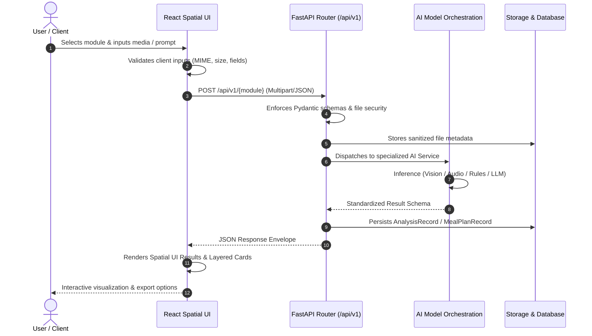

# FoodVerse AI — End-to-End Project Workflow

**Document ID:** WF-2026-V1  
**Project:** FoodVerse AI — Multimodal Food Intelligence Agent  

---

## 1. High-Level System Workflow

FoodVerse AI integrates multimodal inputs into actionable food intelligence across five specialized modules:

---

## 2. Six GitHub Epics Progression

The implementation follows six strictly ordered GitHub epics:

| Epic ID | Title | Documentation Link | Status |
|:---|:---|:---|:---|
| **EPIC 1** | Requirements Specification and Environment Setup | [EPIC-1](../epics/EPIC-1-requirements-environment.md) | ✅ Completed |
| **EPIC 2** | Food Recognition & Nutrition Module Development | [EPIC-2](../epics/EPIC-2-food-recognition-nutrition.md) | ✅ Completed |
| **EPIC 3** | Food Freshness & Spoilage Detection Module | [EPIC-3](../epics/EPIC-3-freshness-spoilage.md) | ✅ Completed |
| **EPIC 4** | Restaurant Hygiene & Smart Kitchen Modules | [EPIC-4](../epics/EPIC-4-hygiene-smart-kitchen.md) | ✅ Completed |
| **EPIC 5** | Personalized Meal Planner Development | [EPIC-5](../epics/EPIC-5-personalized-meal-planner.md) | ✅ Completed |
| **EPIC 6** | Interface, Testing, and Deployment | [EPIC-6](../epics/EPIC-6-interface-testing-deployment.md) | ✅ Completed |

---

## 3. Operational Prerequisites

### Mandatory
- **Python:** 3.11+ (Python 3.13 tested and verified)
- **Node.js:** v18.0.0+ (Node v24.16.0 tested and verified)
- **Package Managers:** `pip` and `npm`
- **Operating System:** Windows, macOS, or Linux
- **Local Storage:** SQLite (built-in, no installation required)

### Optional
- **External AI Credentials:** `OPENAI_API_KEY` or `GEMINI_API_KEY` for advanced generative capabilities (local inference engines are active by default).
- **PostgreSQL Database:** Supported via `DATABASE_URL` for high-concurrency production deployments.
- **USDA FoodData Central API Key:** For real-time USDA cloud queries beyond the bundled 120-food composition database.
